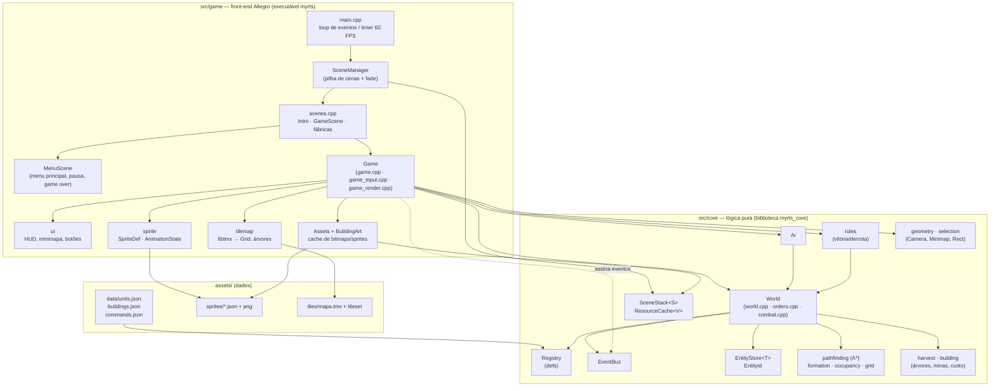
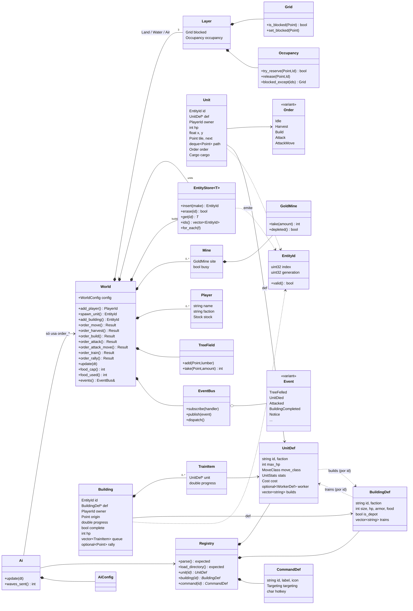
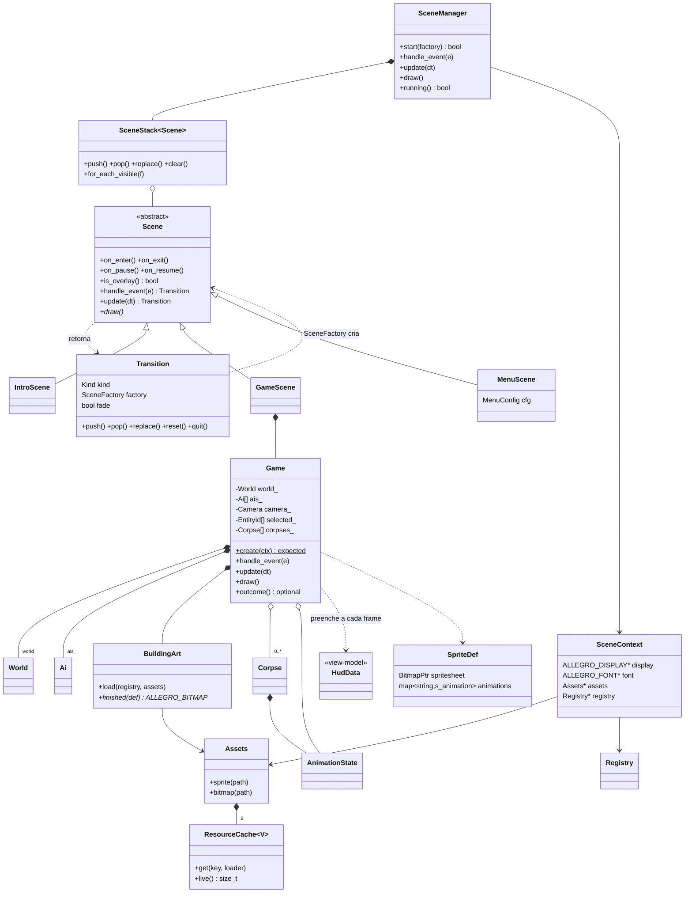
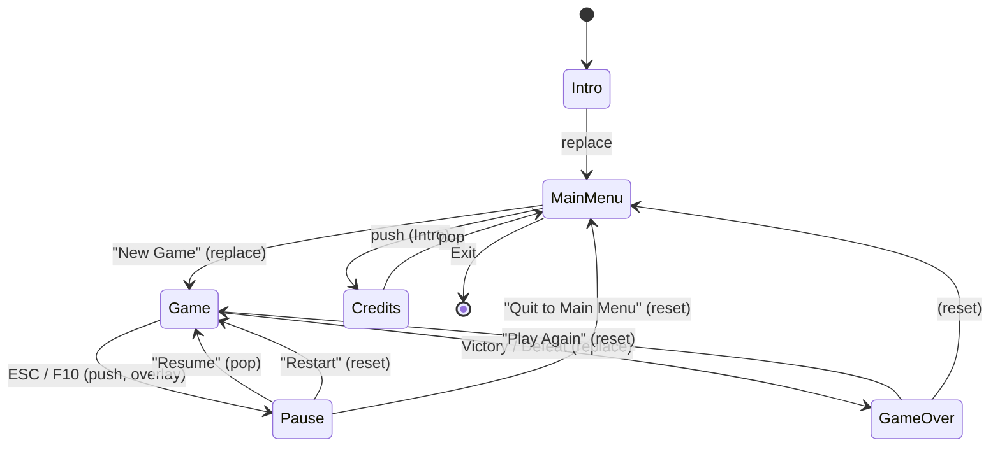
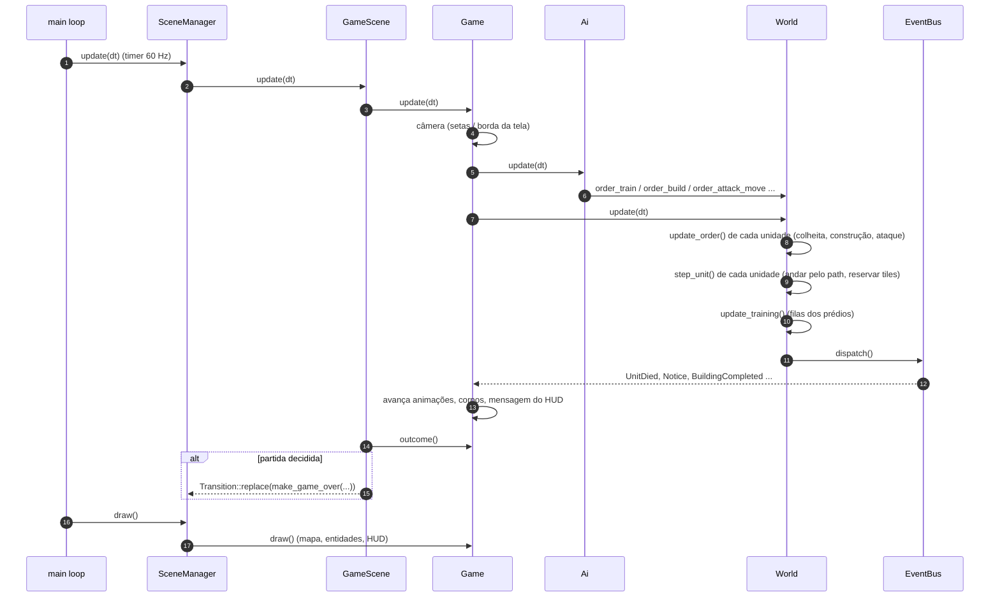
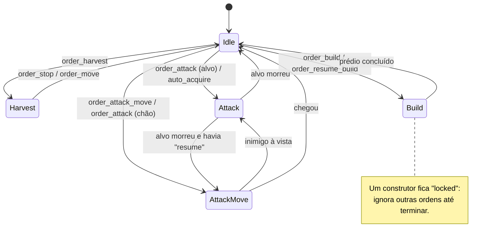

# myrts – visão geral do sistema

Protótipo de RTS (estilo Warcraft II) em C++23. Duas facções (Horde e Aliança), coleta de recursos,
construção, treinamento, combate, IA adversária e um front-end gráfico em Allegro 5.

> Este documento explica **como as peças se encaixam**. Para detalhes por classe/função veja a
> documentação de API gerada pelo Doxygen (`scripts/docs.sh`, saída em `build/docs/html/index.html`).
> Para receitas ("como adicionar uma unidade") veja [ARCHITECTURE.md](ARCHITECTURE.md).

## 1. A ideia central

O projeto é dividido em **duas bibliotecas/camadas** com uma regra de dependência de mão única:

| Camada | Pasta | Depende de | Testada? |
|---|---|---|---|
| **core** (`myrts_core`) | `src/core/` | só a STL e nlohmann-json | Sim, *headless* (Catch2) |
| **game** (`myrts`) | `src/game/` | `core`, Allegro 5, libtmx | Não (verifica-se rodando) |

* `core` contém **todas as regras do jogo**: movimento, coleta, construção, combate, treinamento, comida,
  IA, vitória/derrota. Não sabe o que é pixel, janela, mouse ou som.
* `game` apenas **traduz**: cliques viram *ordens* (`World::order_*`), e o estado do `World` (mais os
  eventos que ele publica) vira imagem na tela.
* Os **dados** (unidades, prédios, comandos) vivem em JSON (`assets/data/*.json`), não em código.

## 2. Diagrama de módulos



Leitura rápida: setas sempre apontam de quem **usa** para quem **é usado**. Nada em `core` aponta para
`game` — é isso que permite rodar o jogo inteiro em testes.

### Responsabilidade de cada módulo

| Módulo | Arquivos | O que faz |
|---|---|---|
| `World` | `core/world.*`, `orders.cpp`, `combat.cpp` | A simulação. Terreno (3 classes de movimento), unidades, prédios, minas, árvores, jogadores, ordens e *tick*. |
| `Registry` | `core/defs.*` | Carrega e valida `units/buildings/commands.json`. Imutável depois de carregado. |
| `EntityStore<T>` / `EntityId` | `core/entity_store.hpp`, `ids.hpp` | *Slot map* com *generation*: ids de entidades mortas ficam inválidos, mesmo se o slot for reaproveitado. |
| `EventBus` | `core/events.hpp` | Fila de eventos (`UnitDied`, `Attacked`, `Notice`…). O `World` publica, o `Game` escuta. |
| `Ai` | `core/ai.*` | Jogador computador. Usa as mesmas `order_*` públicas de um humano. |
| `rules` | `core/rules.*` | `evaluate_outcome`: vitória/derrota. |
| Navegação | `pathfinding`, `formation`, `occupancy`, `grid` | A\* em grade 8-conexa, destinos distintos para grupos, reserva de tiles. |
| Economia | `harvest`, `building` | `TreeField`, `GoldMine`, `Stock`/`Cost`, `footprint`/`can_place`. |
| Geometria | `geometry`, `selection` | `Camera`, `Minimap`, `Rect`, seleção por clique/caixa. |
| Infra | `scene_stack`, `resource_cache` | Pilha de cenas genérica e cache de recursos com *weak_ptr*. |
| `SceneManager` + cenas | `game/scene*`, `scenes`, `menu_scene` | Ciclo de vida de telas (intro, menu, jogo, pausa, game over) com *fade*. |
| `Game` | `game/game*.cpp` | Uma partida vista pelo jogador: câmera, seleção, comandos, HUD, desenho. |
| `ui` | `game/ui.*` | HUD desenhado a partir de *view-models* (`HudData`, `UnitCard`…). |
| `sprite`, `Assets`, `BuildingArt`, `tilemap` | `game/*` | Animações, cache de imagens, arte de prédios e mapa Tiled. |

## 3. Diagrama de classes

### 3.1 Núcleo (`src/core`)



### 3.2 Front-end (`src/game`)



(`World`, `Ai` e `Registry` são as classes do núcleo do diagrama anterior.)

## 4. Fluxo de uma partida

### 4.1 Ciclo de cenas



Uma cena nunca instancia outra diretamente: devolve uma `Transition` com uma `SceneFactory`.
O `SceneManager` aplica a transição **entre** chamadas (nunca no meio de um método da cena) e, se
pedido, faz fade para preto. Enquanto uma fábrica roda, a cena antiga ainda existe — se o carregamento
falha, o jogo continua onde estava.

### 4.2 Um quadro (tick) da partida



Entrada do jogador (mouse/teclado) chega por `Game::handle_event`, que a converte numa chamada
`World::order_*` — o único caminho para alterar a simulação.

### 4.3 Ordens de uma unidade



`Harvest` tem seu próprio subciclo: `ToResource → Working → ToDepot → ToResource …`.
Mover-se **não** é uma ordem: é só seguir o `path` da unidade.

## 5. Conceitos que aparecem em todo lugar

* **`EntityId` em vez de ponteiros.** Unidades e prédios se referenciam só por id
  (`index` + `generation`). Uma unidade pode morrer sem invalidar quem a mirava: `get(id)` devolve `nullptr`.
* **Classes de movimento** (`Land`, `Water`, `Air`). Cada uma tem sua grade de bloqueio e ocupação
  (`World::Layer`). Unidades aéreas só são limitadas pela borda do mapa.
* **Ocupação de tiles.** Uma unidade em movimento reserva o tile atual e o próximo (`Occupancy`).
  Se o próximo está ocupado, ela espera um instante e replaneja evitando os tiles alheios.
* **Pathfinding.** A\* de agente único, 8-conexo, sem cortar quinas. Para grupos, `assign_destinations`
  escolhe tiles livres próximos ao alvo e os distribui às unidades; cada unidade roda o A\* até o seu.
* **Comida.** Prédios concluídos fornecem (`food`), unidades consomem vivas *ou na fila*. `order_train` recusa acima do teto.
* **Combate.** Dano = rolagem entre `damage_min` e `damage_max` menos `armor` (mínimo 1), usando o RNG
  com *seed* do `World` — mesma seed, mesma luta. `siege_multiplier` multiplica o dano contra prédios.
* **Eventos.** O `World` enfileira eventos durante o `update` e só os entrega no fim (`dispatch`), então
  um *handler* nunca roda no meio de uma mudança de estado.
* **Dados primeiro.** Novas unidades/prédios/comandos são entradas JSON; veja "Adding content" em
  [ARCHITECTURE.md](ARCHITECTURE.md).
* **RAII para tudo do Allegro.** `raii.hpp` embrulha `ALLEGRO_BITMAP`, `tmx_map` etc. Cenas são donas dos
  seus recursos e os liberam no destrutor; `Assets` guarda só `weak_ptr`.

## 6. Mapa do código

```
src/core/
  world.hpp/.cpp      World: estado, spawn, movimento (step_unit), update
  orders.cpp          order_* e handlers de Harvest/Build (parte da classe World)
  combat.cpp          ataque, auto-aquisição de alvos, treinamento (parte da classe World)
  defs.hpp/.cpp       Registry e *Def (dados carregados de JSON)
  ai.hpp/.cpp         jogador computador
  rules.hpp/.cpp      vitória / derrota
  entity_store.hpp    slot map; ids.hpp: EntityId, PlayerId
  events.hpp          EventBus e os tipos de evento
  grid.hpp            Point, Grid
  pathfinding.*       a_star, path_to_adjacent, is_adjacent
  formation.*         assign_destinations
  occupancy.hpp       reserva de tiles
  harvest.*           TreeField, ApproachPath
  building.*          Stock/Cost, GoldMine, footprint, can_place
  geometry.hpp        Vec2, Rect, Camera, Minimap
  selection.hpp       pick_at, pick_in
  scene_stack.hpp     SceneStack<S>;  resource_cache.hpp: ResourceCache<V>
src/game/
  main.cpp            inicialização do Allegro e loop principal
  scene*.{hpp,cpp}    Scene, Transition, SceneManager
  scenes.*            IntroScene, GameScene e fábricas make_*
  menu_scene.*        MenuScene (menus configuráveis)
  game.hpp/.cpp       Game: criação da partida, comandos, update
  game_input.cpp      mouse e teclado → ordens
  game_render.cpp     desenho do mundo
  ui.*                HUD (view-models + desenho)
  sprite.*            SpriteDef, animações
  assets.*, building_art.*, tilemap.*, raii.hpp, draw_util.*
tests/                Catch2: um arquivo por módulo do core
assets/               data/*.json, sprites, tiles, prédios
```
